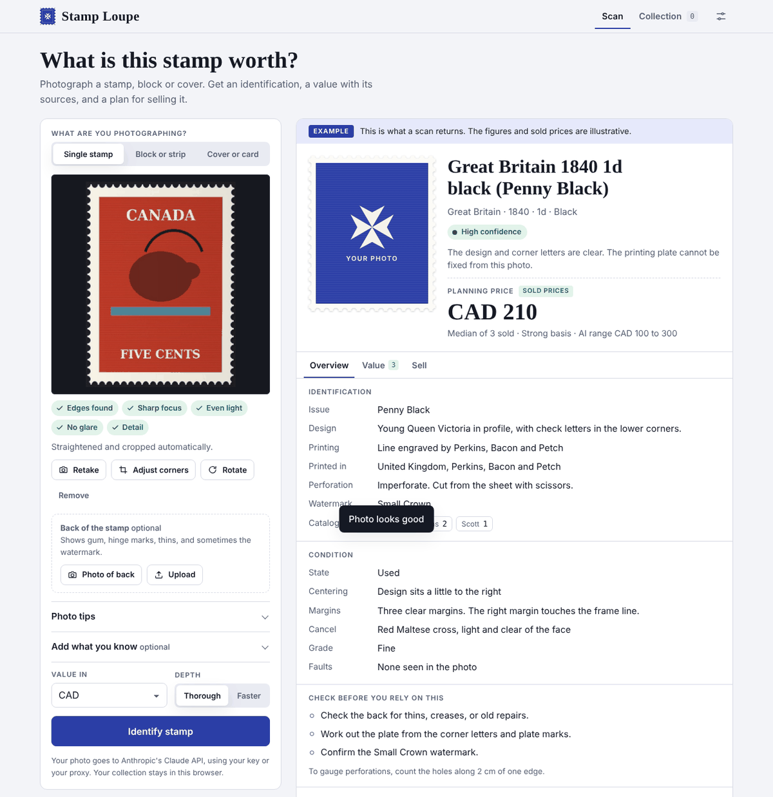
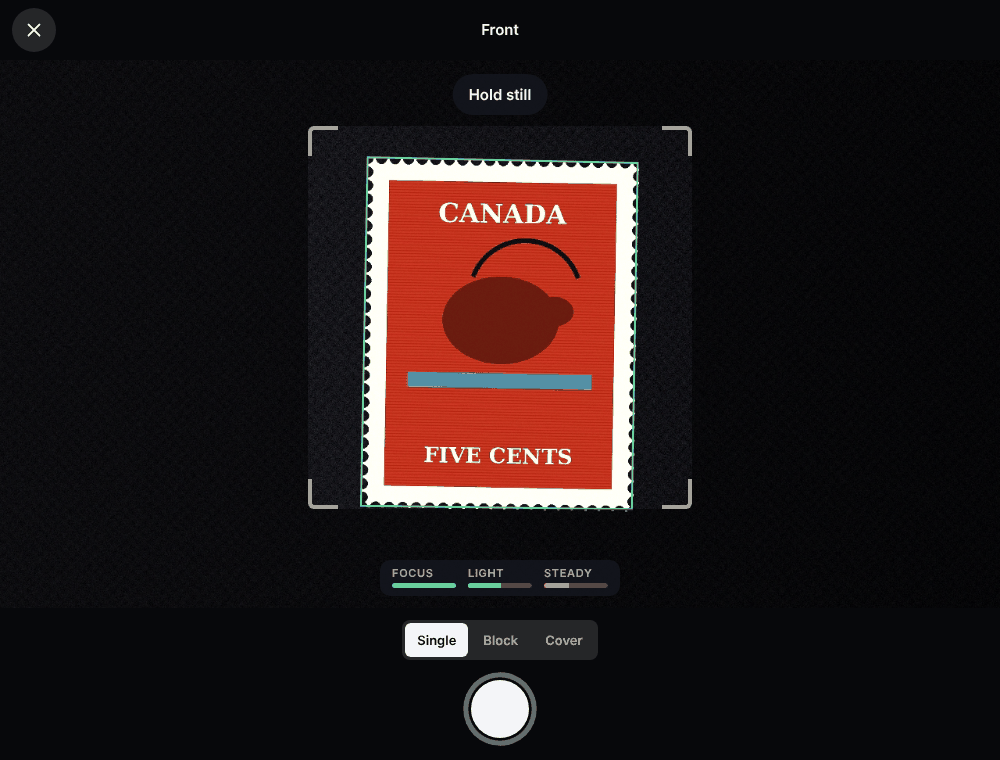
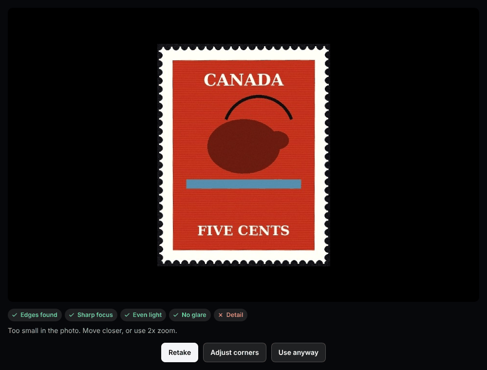
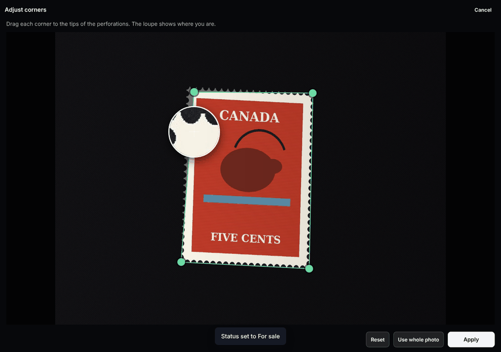
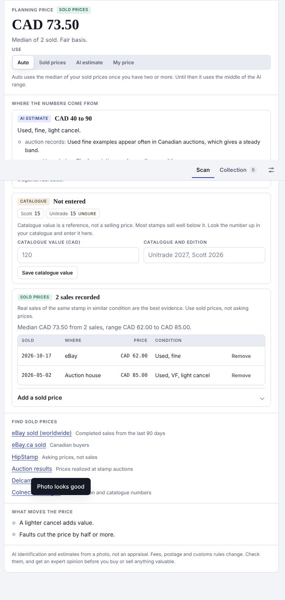
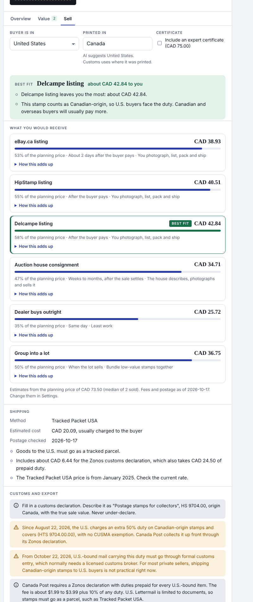
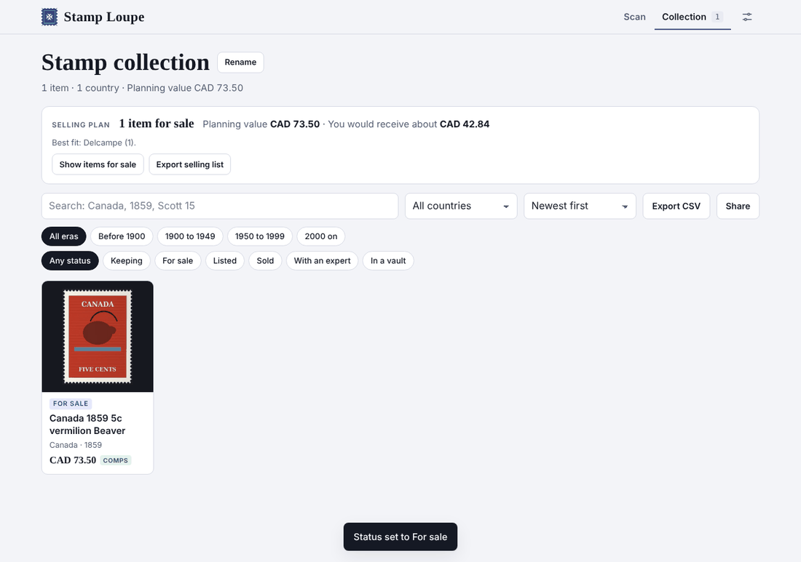
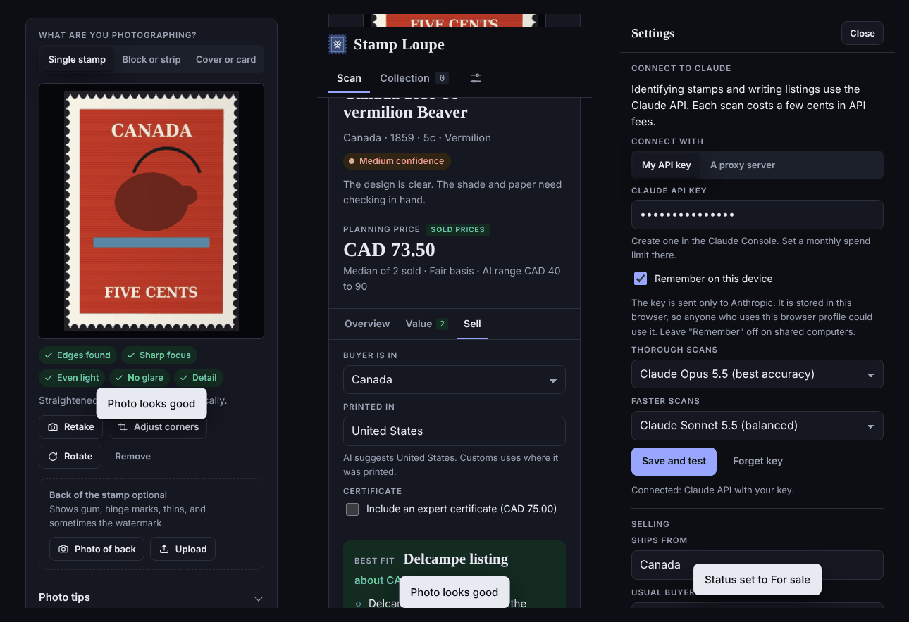
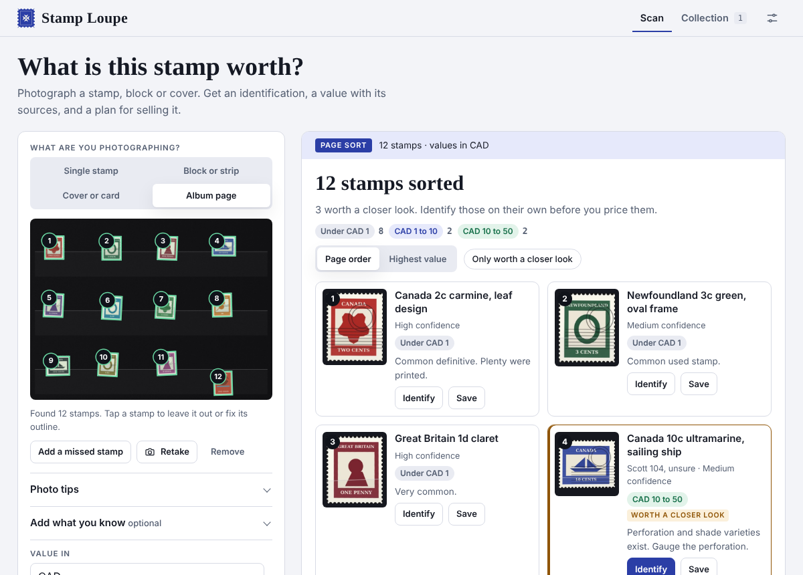
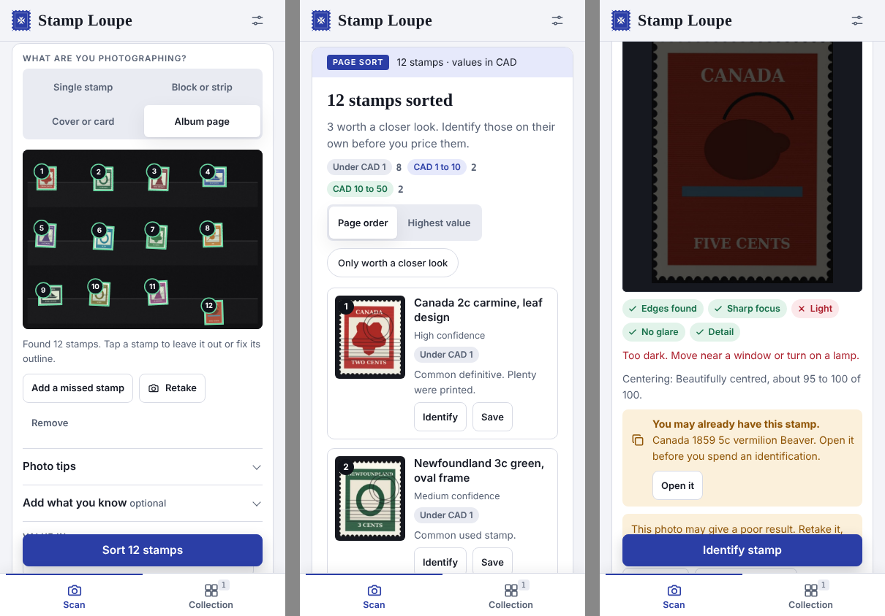

# Stamp Loupe

An open-source tool for postage stamp collectors. Photograph a stamp, a block, a cover or a whole album page. Stamp Loupe straightens and checks the photo, identifies the item with Claude, shows a value along with where that value comes from, and helps you plan a sale: which channel leaves you the most, how to ship it, and what customs rules apply.



## What it does

- **Guided capture.** On phones and browsers that allow camera access, a live guide works like a banking app photographing a cheque. A square frame for single stamps and wider frames for blocks and covers tell you to move closer, centre the stamp, straighten it or hold still. When the stamp is square, sharp and free of glare, the app takes the photo for you, and keeps the sharpest frame of the hold.
- **Automatic straightening and quality checks.** Every photo, from the live guide, your phone's camera app or a file, is cropped to the stamp and corrected for perspective. Five checks follow: edges found, focus, light, glare and detail. Each one comes with a plain fix if it fails.
- **Measured centering.** The design's position between the margins is measured on the device and shown as a score range, such as "about 80 to 90 of 100". Claude sees the measurement too.
- **Album pages.** Photograph a whole album or stockbook page. Every stamp on it is found on the device, outlined and numbered. Up to 30 go to Claude on one numbered sheet for a quick sort: a name, a value band, and a flag on the few worth a closer look.
- **Duplicate check.** Each photo gets a small picture signature. Before you spend an identification, the app tells you when the stamp looks like one you already have.
- **Corner editor.** Drag four corners to the perforation tips, with a magnifying loupe under your finger, when automatic cropping misses.
- **Identification.** Country, year, issue, catalogue numbers marked "likely" or "unsure", condition, faults, warning signs of forgery or repair, look-alikes and how to tell them apart, and whether a certificate is worth getting.
- **Value with its sources.** The AI estimate shows what it rests on. You can add catalogue values and real sold prices. The planning price says whether it comes from sold prices, the AI or you, and how strong that basis is.
- **Sell planner.** Compares eBay.ca, HipStamp, Delcampe, an auction house consignment, a dealer offer and selling in a lot by what you would actually receive. It picks a shipping method by value and destination, and lists the customs and export rules that apply. Fee and postage figures are dated and sourced, and you can edit them.
- **Listing writer.** Honest, channel-specific listings built from the identification, with shipping and customs text taken from the planner rather than invented.
- **Collection.** Search, filters by era and status, a selling summary, CSV export, and a record for each stamp with gum, quantity, where it is kept, certificate details, private custody fields and a SHA-256 provenance fingerprint.
- **Import a list.** Bring in a spreadsheet from Excel, Numbers or Google Sheets, a Colnect export or StampManage. Columns are matched in English and German.
- **Installable.** Add the hosted app to a phone's home screen. It opens with no connection, and on Android you can share photos to it from the gallery.

## Two ways to run it

| | On your own site (GitHub Pages or any host) | As a Claude artifact |
|---|---|---|
| AI | Claude API, with your key or through your proxy | Your Claude account |
| Collection storage | This browser (IndexedDB), with backup files | The artifact's storage, shareable from Claude |
| Live auto-capture | Yes, on https pages | No. Claude artifacts cannot open the camera, so the phone's camera app is used and the photo is then checked and straightened |
| Install and offline use | Yes | No |
| Setup | Add an API key in Settings | None |

## Quick start

**Use it in your browser.** After you deploy (see below), open `https://YOUR-USERNAME.github.io/stamp-loupe/app/`, open Settings, and add a Claude API key or a proxy address. The app works without one for capture, photo checks, page detection and the duplicate check. Identifying, sorting and listing need Claude. The address without `/app/` is the launch page.

**Run it on your computer.**

```bash
git clone https://github.com/YOUR-USERNAME/stamp-loupe.git
cd stamp-loupe
npm install
npm test
npm run serve    # then open http://localhost:8080
```

Browsers treat `localhost` as a secure page, so the live camera works there too.

**Deploy it.** Push to GitHub and turn on Pages with "GitHub Actions" as the source. The included workflow runs the tests, builds the launch page, the app and the single-file version, and publishes them. Details, custom domains and other hosts are in [docs/deployment.md](docs/deployment.md).

**Build the Claude artifact.** `npm run build` writes `dist/stamp-loupe.html`, a single self-contained file. Publish it as a Claude artifact with the capabilities listed in [docs/deployment.md](docs/deployment.md).

## What you need to connect

Only the Claude API, and only when the app runs outside Claude.

- **Your own key.** Each person pastes a key from the Claude Console into Settings. It stays in their browser and is sent only to Anthropic.
- **A proxy.** If you host the app for other people, deploy the small Cloudflare Worker in [server/](server/README.md). Your key stays on the server, and the worker only accepts requests from your site.

A scan costs a few cents of API usage. The cost depends on the model you choose in Settings and on whether you add a photo of the back. A page sort of up to 30 stamps costs about the same as one identification. See [Claude pricing](https://platform.claude.com/docs/en/about-claude/pricing).

No database is needed. Live postage rates, eBay sold prices and cloud sync are on the [roadmap](docs/roadmap.md) and would plug into the proxy.

## Screens

| Live guide | Review | Corner editor |
|---|---|---|
|  |  |  |

| Value and sources | Sell planner | Collection |
|---|---|---|
|  |  |  |



**Album pages.** One photo of a stockbook page: every stamp found and numbered, then sorted by value band, with the ones worth a closer look marked.





## Documentation

- [User guide](docs/user-guide.md): taking good photos, reading a result, pricing, selling, the collection, settings and backups.
- [Selling rules and sources](docs/selling-rules.md): every fee, postage and customs figure the planner uses, with dates and sources.
- [How capture works](docs/capture.md): edge finding, perspective correction, focus and glare checks, and the live guide.
- [Architecture](docs/architecture.md): modules, the stamp record, storage and the AI contract.
- [Deployment](docs/deployment.md): GitHub Pages, custom domains, the proxy and the Claude artifact.
- [Privacy](docs/privacy.md): what leaves your device, and when.
- [Related projects](docs/related-projects.md): open-source work to learn from.
- [Roadmap](docs/roadmap.md): what could come next.
- [Contributing](CONTRIBUTING.md), [Security](SECURITY.md), [Code of conduct](CODE_OF_CONDUCT.md), [Changelog](CHANGELOG.md).

## Project layout

```
index.html              App shell for the hosted version
manifest.webmanifest    Install details: name, icons, shortcuts, share target
sw.js                   Service worker for offline use (built site only)
src/main.js             Entry point: detects the platform and wires the views
src/app/                Views: scan, page sort, stamp card tabs, collection, settings, import
src/capture/            Vision engine, photo pipeline, live camera, corner editor,
                        page detection, centering and picture signatures
src/ai/                 Prompts, response cleanup, Claude providers
src/sell/               Sell planner and the dated fee, postage and customs rules
src/store/              IndexedDB storage and Claude artifact storage
src/util/               DOM, formatting and CSV helpers
site/                   The launch page
assets/                 App icons
server/                 Optional Cloudflare Worker proxy for the Claude API
scripts/                Builds: the hosted site and the single-file Claude artifact
tests/                  Node tests, including synthetic stamp and album page images
docs/                   Documentation and screenshots
```

Plain JavaScript modules, no framework, no runtime dependencies. The only development dependency is esbuild, which bundles the hosted app and the single-file build.

## Tests

```bash
npm test
```

The tests cover the vision engine on synthetic stamps (rotation, perspective, light and dark backgrounds, cut-off edges, blur, glare and darkness), page detection on synthetic album and stockbook pages, centering, picture signatures and duplicate matching, the list importer, the sell planner (planning price, shipping, U.S. duty and formal entry dates, export permits, Delcampe's buyer fee), and the text, CSV and response normalisers. [CONTRIBUTING.md](CONTRIBUTING.md) explains how to test the live camera with a fake video feed.

## Limits

Stamp Loupe gives a starting point, not an appraisal. Identification from a photo can miss perforation, watermark, paper and shade differences that decide value, and the AI has no live market data. Fees, postage, duties and customs rules change, sometimes quickly. The U.S. rules for Canadian-origin stamps changed twice in the autumn of 2026. Check figures before you rely on them, and get an expert certificate before you buy or sell anything valuable.

## License

MIT. See [LICENSE](LICENSE). The centering measure is ported from [stamp-grader](https://github.com/DanMat/stamp-grader) under the Apache License 2.0. [NOTICE.md](NOTICE.md) lists it, and the other projects whose ideas or facts were reused.

Fonts are Old Standard TT, Schibsted Grotesk and IBM Plex Mono, served by Google Fonts under the SIL Open Font License. The focus check uses the blur measure described by Crete-Roffet, Dolmiere, Ladret and Nicolas (2007), "The blur effect: perception and estimation with a new no-reference perceptual blur metric".
